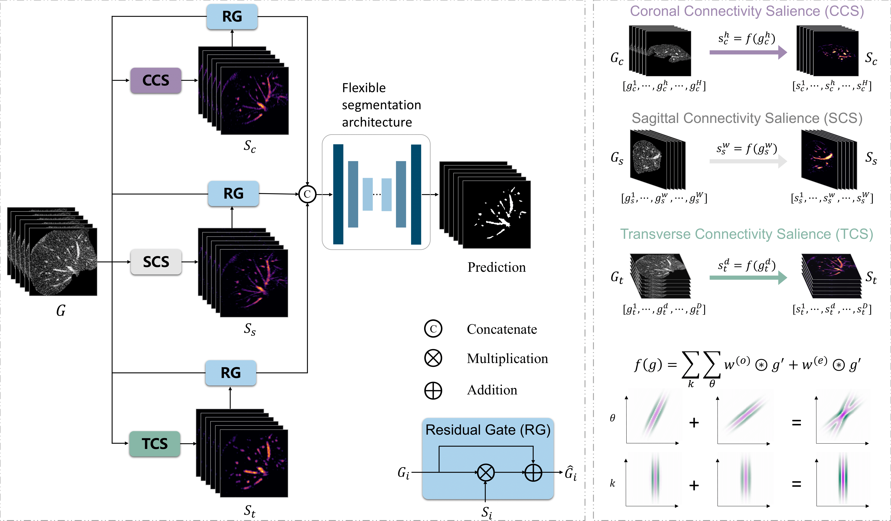

# Connectivity-aware salience demystifies inconspicuous liver vessel segmentation

- Implementation of our work: [Connectivity-aware salience demystifies inconspicuous liver vessel segmentation](https://arxiv.org/abs/xxxx.xxxxx).



## Abstract

Inconspicuous liver vessels are notoriously hard to segment due to their low contrast against
surrounding parenchyma, thin tubular geometry and fragmented appearance in 3D CT volumes.
ConSalience introduces a **connectivity-aware salience** transformation that explicitly encodes
local connectivity and vesselness priors into the network input, so that low-contrast vessels
become salient before the encoder ever sees them. The pipeline is model-agnostic and can be
plugged into almost any 3D encoder–decoder backbone.

---

## 0. Prepare Data

1. Sign up on the [official 3D-IRCADb website](https://www.ircad.fr/research/data-sets/liver-segmentation-3d-ircadb-01/) and download the **3D-IRCADb** liver CT dataset.

2. Download the **MSD (Medical Segmentation Decathlon) Liver** dataset from the official challenge website:  
   https://decathlon.grand-challenge.org  
   (Task 03 – Liver, direct data link: https://msd-for-monai.s3-us-west-2.amazonaws.com/Task03_Liver.tar)

3. Download the **LiTS / LiVS liver dataset** from the LiTS challenge site:  
   https://competitions.codalab.org/competitions/17094  
   (original LiTS data; use your own preprocessing pipeline to derive the “LiVS” variant used in this project)

4. Convert all CT volumes to NumPy arrays, clip the intensities to `[0, 400]`, normalize each 3D image to `[0, 1]`, and then transform the 3D NumPy arrays to HDF5 (`.h5`) format for training and testing.

5. For reproduction, you can also request our preprocessed data by sending an email to: `xiaoxu_u@qq.com`.

6. The overall project structure is as follows.

---

# 🔻 ConSalience

ConSalience is a framework for **3D vessel segmentation** with multiple encoder–decoder architectures and a configurable **salience-based input enhancement** pipeline.

The framework supports:

- 3D U-Net
- Attention U-Net
- Y-Net
- UNeXt
- Swin U-Net
- H-V-Mamba U-Net
- MambaVesselNet
- Plain CT input
- Normalized salience input
- CT plus salience input
- Per-case CSV export
- Optional paired statistical comparison with p-values

---

## 1. Project Structure

```text
ConSalience/
├── src/
│   ├── config/
│   │   └── unet3d.yaml
│   ├── models/
│   │   ├── unet3d.py
│   │   ├── AttnUNet3D.py
│   │   ├── YNet.py
│   │   ├── UNeXt.py
│   │   ├── DSwinUNet.py
│   │   ├── Hvmunet.py
│   │   ├── MambaVesselNet.py
│   │   ├── build_model.py
│   │   └── __init__.py
│   ├── salience/
│   ├── trainer/
│   └── utils/
├── scripts/
│   ├── train.py
│   ├── train_salience.py
│   └── eval.py
├── data/
│   └── preprocessed/
├── checkpoints/
├── results/
└── README.md
```

---

## 2. Environment

The project requires Python 3.9 or higher. A CUDA-enabled GPU is recommended.

Create a conda environment:

```bash
conda create -n consalience python=3.10 -y
conda activate consalience
```

Install PyTorch according to your CUDA version:

```bash
pip install torch torchvision torchaudio
```

Install the remaining dependencies:

```bash
pip install numpy scipy pyyaml tqdm scikit-image
```

If the repository contains a `requirements.txt` file, you can also run:

```bash
pip install -r requirements.txt
```

Check the installation:

```bash
python - <<'PY'
import torch

print("PyTorch:", torch.__version__)
print("CUDA available:", torch.cuda.is_available())

if torch.cuda.is_available():
    print("CUDA device:", torch.cuda.get_device_name(0))
PY
```

---

## 3. Data Preparation

The default data paths are defined in `src/config/unet3d.yaml`.

Example:

```yaml
data:
  root_dir: data/preprocessed
  split_path: data/preprocessed/splits.json
```

A typical data structure is:

```text
data/
└── preprocessed/
    ├── 3Dircadb1/
    ├── MSD/
    ├── LiVS/
    └── splits.json
```

The `splits.json` file should contain the train, validation, and test case lists for each dataset.

Before training, please ensure:

- Image and mask volumes are spatially aligned.
- Masks are binary.
- Case IDs in `splits.json` match the corresponding files.
- `root_dir` and `split_path` point to the correct locations.

Supported datasets include:

- `3Dircadb1`
- `MSD`
- `LiVS`

---

## 4. Supported Models

The backbone is selected via `model.name` in the configuration file.

| `model.name` | Model |
| --- | --- |
| `UNet3D` | 3D U-Net |
| `AttnUNet3D` | Attention U-Net |
| `AttnUNet` | Alias of `AttnUNet3D` |
| `YNet` | Y-Net |
| `UNeXt` | UNeXt-style 3D net |
| `DSwinUNet` | Swin U-Net |
| `HVMUNet` | H-V-Mamba U-Net |
| `MambaVesselNet` | MambaVesselNet |

Models are constructed through `build_model.py`:

```python
from src.models.build_model import build_model

model = build_model(cfg["model"])
logits = model(images)  # logits shape: (B, 1, D, H, W)
```

Expected tensor shapes:

- Input: `(B, C, D, H, W)`
- Output: `(B, 1, D, H, W)`

---

## 5. Configuration

The default configuration file is `src/config/unet3d.yaml`.

### 5.1 Baseline Configuration (CT-only)

Example configuration using single-channel CT input without salience:

```yaml
seed: 2024

model:
  name: UNet3D
  in_channels: 1
  out_channels: 1
  base_channels: 16

data:
  dataset: MSD
  root_dir: data/preprocessed
  split_path: data/preprocessed/splits.json
  use_salience: false

train:
  epochs: 100
  batch_size: 1
  lr: 0.001
  weight_decay: 0.0001
  num_workers: 4
  save_dir: checkpoints/unet3d_msd_baseline
```

### 5.2 Normalized Salience Configuration (3-channel)

Example configuration using three-channel normalized salience input:

```yaml
model:
  name: UNet3D
  in_channels: 3
  out_channels: 1
  base_channels: 16

data:
  dataset: MSD
  root_dir: data/preprocessed
  split_path: data/preprocessed/splits.json
  use_salience: true

salience:
  plugin: normalized
  input_mode: salience_only
  K: 1
  delta_theta: 90
  delta_sigma: 1.0
  alpha: 0.5
```

### 5.3 Command-Line Overrides

Configuration values can be overridden using dot notation. Use **one** `--override` argument and place all overrides after it:

```bash
--override model.name=UNeXt data.dataset=MSD train.save_dir=checkpoints/unext_msd_baseline
```

Example:

```bash
python scripts/train.py \
  --cfg src/config/unet3d.yaml \
  --override model.name=UNeXt data.dataset=MSD train.save_dir=checkpoints/unext_msd_baseline
```

---

## 6. Training

### 6.1 Baseline Training (no salience)

**3D U-Net**

```bash
python scripts/train.py \
  --cfg src/config/unet3d.yaml \
  --override model.name=UNet3D data.dataset=MSD train.save_dir=checkpoints/unet3d_msd_baseline
```

**Attention U-Net**

```bash
python scripts/train.py \
  --cfg src/config/unet3d.yaml \
  --override model.name=AttnUNet3D data.dataset=MSD train.save_dir=checkpoints/attnunet3d_msd_baseline
```

**Y-Net**

```bash
python scripts/train.py \
  --cfg src/config/unet3d.yaml \
  --override model.name=YNet data.dataset=MSD train.save_dir=checkpoints/ynet_msd_baseline
```

**UNeXt**

```bash
python scripts/train.py \
  --cfg src/config/unet3d.yaml \
  --override model.name=UNeXt data.dataset=MSD train.save_dir=checkpoints/unext_msd_baseline
```

**H-V-Mamba U-Net**

```bash
python scripts/train.py \
  --cfg src/config/unet3d.yaml \
  --override model.name=HVMUNet data.dataset=MSD train.save_dir=checkpoints/hvmunet_msd_baseline
```

**MambaVesselNet**

```bash
python scripts/train.py \
  --cfg src/config/unet3d.yaml \
  --override model.name=MambaVesselNet data.dataset=MSD train.save_dir=checkpoints/mambavesselnet_msd_baseline
```

### 6.2 Training with Normalized Salience (3-channel)

**UNet3D + normalized salience**

```bash
python scripts/train_salience.py \
  --cfg src/config/unet3d.yaml \
  --override model.name=UNet3D data.dataset=MSD salience.plugin=normalized train.save_dir=checkpoints/unet3d_msd_norm_salience
```

**AttnUNet3D + normalized salience**

```bash
python scripts/train_salience.py \
  --cfg src/config/unet3d.yaml \
  --override model.name=AttnUNet3D data.dataset=MSD salience.plugin=normalized train.save_dir=checkpoints/attnunet3d_msd_norm_salience
```

**UNeXt + normalized salience**

```bash
python scripts/train_salience.py \
  --cfg src/config/unet3d.yaml \
  --override model.name=UNeXt data.dataset=MSD salience.plugin=normalized train.save_dir=checkpoints/unext_msd_norm_salience
```

---

## 7. Salience Input Modes

Two salience input modes are supported.

### 7.1 Salience-Only Input (3-channel)

```yaml
salience:
  input_mode: salience_only
```

The model receives three salience channels `[Gc, Gs, Gt]`, and the configuration should use:

```yaml
model:
  in_channels: 3
```

### 7.2 CT plus Salience Input (4-channel)

```yaml
salience:
  input_mode: ct_plus_salience
```

The model receives four channels `[CT, Gc, Gs, Gt]`, and the configuration should use:

```yaml
model:
  in_channels: 4
```

Example training command:

```bash
python scripts/train_salience.py \
  --cfg src/config/unet3d.yaml \
  --override model.name=UNet3D data.dataset=MSD salience.plugin=normalized salience.input_mode=ct_plus_salience train.save_dir=checkpoints/unet3d_msd_4ch
```

> **Note:** 3-channel and 4-channel checkpoints are not interchangeable.

---

## 8. Evaluation

**Evaluate a baseline model**

```bash
python scripts/eval.py \
  --cfg src/config/unet3d.yaml \
  --ckpt checkpoints/unet3d_msd_baseline/best.pth \
  --dataset MSD \
  --use_salience false \
  --save_csv results/unet3d_msd_baseline.csv
```

**Evaluate an Attention U-Net baseline**

```bash
python scripts/eval.py \
  --cfg src/config/unet3d.yaml \
  --ckpt checkpoints/attnunet3d_msd_baseline/best.pth \
  --dataset MSD \
  --use_salience false \
  --save_csv results/attnunet3d_msd_baseline.csv
```

**Evaluate a UNeXt with normalized salience (custom threshold)**

```bash
python scripts/eval.py \
  --cfg src/config/unet3d.yaml \
  --ckpt checkpoints/unext_msd_norm_salience/best.pth \
  --dataset MSD \
  --use_salience true \
  --threshold 0.25 \
  --bootstrap 1000 \
  --save_csv results/unext_msd_norm_salience.csv
```

The evaluation script reports the final configuration and aggregated test results, and it supports per-case CSV export.

---

## 9. CSV Results and p-values

### 9.1 Save Per-Case Results

Use `--save_csv` to save evaluation results:

```bash
python scripts/eval.py \
  --cfg src/config/unet3d.yaml \
  --ckpt checkpoints/unext_msd_baseline/best.pth \
  --dataset MSD \
  --use_salience false \
  --save_csv results/unext_msd_baseline.csv
```

Example CSV:

```csv
case_id,DSC,clDice,IoU,Sensitivity,Specificity,HD95,ASSD
case_001,0.6012,0.6321,0.4510,0.6412,0.9988,12.4,2.3
case_002,0.5780,0.6010,0.4360,0.6100,0.9985,14.1,2.8
```

### 9.2 Compare Against a Baseline

First save the baseline results:

```bash
python scripts/eval.py \
  --cfg src/config/unet3d.yaml \
  --ckpt checkpoints/unext_msd_baseline/best.pth \
  --dataset MSD \
  --use_salience false \
  --save_csv results/unext_msd_baseline.csv
```

Then evaluate the new model and provide the baseline CSV:

```bash
python scripts/eval.py \
  --cfg src/config/unet3d.yaml \
  --ckpt checkpoints/unext_msd_norm_salience/best.pth \
  --dataset MSD \
  --use_salience true \
  --save_csv results/unext_msd_norm_salience.csv \
  --baseline_csv results/unext_msd_baseline.csv
```

The script matches cases using `case_id` and reports paired differences, test statistics, and p-values.

---

## 10. Recommended Experiment Organization

Store checkpoints and results using descriptive names:

```text
checkpoints/
├── unet3d_msd_baseline/
├── attnunet3d_msd_baseline/
├── ynet_msd_baseline/
├── unext_msd_baseline/
├── hvmunet_msd_baseline/
├── mambavesselnet_msd_baseline/
├── unet3d_msd_norm_salience/
└── attnunet3d_msd_norm_salience/
```

```text
results/
├── unet3d_msd_baseline.csv
├── attnunet3d_msd_baseline.csv
├── ynet_msd_baseline.csv
├── unext_msd_baseline.csv
├── hvmunet_msd_baseline.csv
└── unext_msd_norm_salience.csv
```

For a fair comparison:

- Use the same dataset split.
- Use the same preprocessing pipeline.
- Use the same training and evaluation settings.
- Use the same prediction threshold.
- Keep baseline and salience experiments in separate directories.

---

## 11. Citation

If you use ConSalience in your research, please cite:

```bibtex
@misc{consalience,
  title        = {Connectivity-aware salience demystifies inconspicuous liver vessel segmentation},
  author       = {{ConSalience Authors}},
  year         = {2026},
  howpublished = {\url{https://github.com/lzhLab/ConSalience}},
  note         = {arXiv preprint}
}
```

Please also cite the original publications corresponding to each backbone architecture you use.

---

## 12. License

Please refer to the `LICENSE` file in this repository (if present) for licensing information.

If no license file is provided, please contact the authors before redistributing or using the code beyond personal research.

---

## 📬 Contact

For preprocessed data or questions, feel free to contact us: `wangyiqi@hbmu.edu.cn`

---
